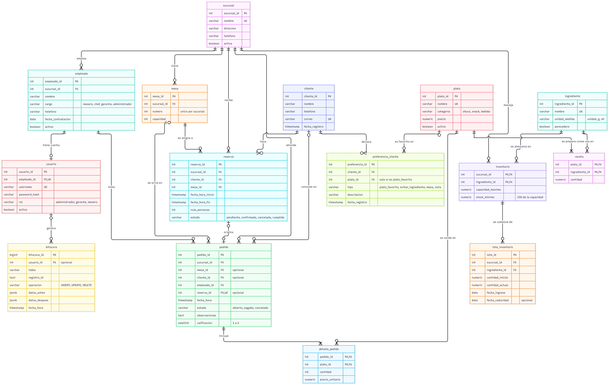

# Documentación del modelo de datos

Shucos El Sapo · Proyecto 2 · CC3088 Base de Datos 1 · UVG · Semestre II 2026

Este documento explica la base de datos del proyecto (PostgreSQL). El diagrama ER está en `docs/DER.png` y el código que crea todo está en la carpeta `sql/`:

| Archivo | Qué contiene |
|---|---|
| `01_schema.sql` | Tablas, llaves, restricciones e índices |
| `02_triggers_vistas.sql` | Triggers y vistas |
| `03_datos_ejemplo.sql` | Datos de ejemplo |

---

## 1. Resumen

| Grupo | Tablas |
|---|---|
| Sucursales y personal | `sucursal`, `empleado`, `usuario` |
| Clientes | `cliente`, `preferencia_cliente` |
| Reservas | `mesa`, `reserva` |
| Ventas | `pedido`, `detalle_pedido`, `plato` |
| Inventario | `ingrediente`, `receta`, `inventario`, `lote_inventario` |
| Control de cambios | `bitacora` |

---

## 2. Descripción de las tablas

### sucursal
Cada restaurante de la cadena (Zona 10, Zona 1, Zona 5 y Antigua).

| Columna | Tipo | Notas |
|---|---|---|
| sucursal_id | integer | **PK**, se genera sola |
| nombre | varchar(60) | obligatorio, **único** |
| direccion | varchar(150) | obligatorio |
| telefono | varchar(20) | opcional, con formato de teléfono válido |
| activa | boolean | por defecto `true` |

### empleado
Las personas que trabajan en una sucursal.

| Columna | Tipo | Notas |
|---|---|---|
| empleado_id | integer | **PK** |
| sucursal_id | integer | **FK** → sucursal, obligatorio |
| nombre | varchar(100) | obligatorio |
| cargo | varchar(20) | `mesero`, `chef`, `gerente` o `administrador` |
| telefono | varchar(20) | opcional, con formato válido |
| fecha_contratacion | date | por defecto la fecha de hoy |
| activo | boolean | por defecto `true` (si es `false`, el empleado está de baja) |

Tiene una restricción única sobre `(empleado_id, sucursal_id)`. Se usa para que `pedido` pueda asegurar que el empleado es de la misma sucursal que el pedido.

### usuario
La cuenta para entrar a la aplicación. Un empleado tiene como máximo una cuenta, y los chefs no tienen.

| Columna | Tipo | Notas |
|---|---|---|
| usuario_id | integer | **PK** |
| empleado_id | integer | **FK** → empleado, obligatorio y **único** |
| username | varchar(40) | obligatorio, **único** |
| password_hash | varchar(100) | contraseña cifrada con bcrypt, nunca en texto plano |
| rol | varchar(15) | `administrador`, `gerente` o `mesero` |
| activo | boolean | por defecto `true`; si es `false` no puede iniciar sesión |

### cliente
Los clientes son de toda la cadena, no de una sola sucursal.

| Columna | Tipo | Notas |
|---|---|---|
| cliente_id | integer | **PK** |
| nombre | varchar(100) | obligatorio |
| telefono | varchar(20) | opcional, con formato válido |
| correo | varchar(100) | opcional, **único** |
| fecha_registro | timestamp | por defecto el momento actual |

### preferencia_cliente
Lo que el cliente declara que le gusta o que no quiere. Un cliente puede tener varias.

| Columna | Tipo | Notas |
|---|---|---|
| preferencia_id | integer | **PK** |
| cliente_id | integer | **FK** → cliente, obligatorio |
| plato_id | integer | **FK** → plato, solo se llena si el tipo es `plato_favorito` |
| tipo | varchar(20) | `plato_favorito`, `evitar_ingrediente`, `mesa` o `nota` |
| descripcion | varchar(200) | opcional |
| fecha_registro | timestamp | por defecto el momento actual |

Un CHECK obliga a que `plato_id` tenga valor si y solo si el tipo es `plato_favorito`.

### mesa
Las mesas de cada sucursal.

| Columna | Tipo | Notas |
|---|---|---|
| mesa_id | integer | **PK** |
| sucursal_id | integer | **FK** → sucursal, obligatorio |
| numero | integer | mayor que 0 |
| capacidad | integer | mayor que 0 |

Dos restricciones únicas: `(sucursal_id, numero)` para que no se repita el número de mesa en una sucursal, y `(mesa_id, sucursal_id)` para que reserva y pedido puedan asegurar que la mesa es de la misma sucursal.

### reserva
Reservas de mesas hechas por clientes.

| Columna | Tipo | Notas |
|---|---|---|
| reserva_id | integer | **PK** |
| sucursal_id | integer | **FK** → sucursal |
| cliente_id | integer | **FK** → cliente |
| mesa_id | integer | **FK** → mesa (junto con sucursal_id) |
| fecha_hora_inicio | timestamp | obligatorio |
| fecha_hora_fin | timestamp | obligatorio, debe ser mayor que el inicio |
| num_personas | integer | mayor que 0 |
| estado | varchar(15) | `pendiente` (por defecto), `confirmada`, `cancelada` o `cumplida` |

### pedido
Un pedido es una visita del cliente al restaurante. Puede venir de una reserva o no, y puede no tener mesa (para llevar) ni cliente registrado.

| Columna | Tipo | Notas |
|---|---|---|
| pedido_id | integer | **PK** |
| sucursal_id | integer | **FK** → sucursal, obligatorio |
| mesa_id | integer | **FK** → mesa, opcional |
| cliente_id | integer | **FK** → cliente, opcional |
| empleado_id | integer | **FK** → empleado, obligatorio (el mesero que atiende) |
| reserva_id | integer | **FK** → reserva, opcional y **único** |
| fecha_hora | timestamp | por defecto el momento actual |
| estado | varchar(10) | `abierto` (por defecto), `pagado` o `cancelado` |
| observaciones | text | opcional, sobre la experiencia del cliente |
| calificacion | smallint | opcional, de 1 a 5 |

### plato
El menú.

| Columna | Tipo | Notas |
|---|---|---|
| plato_id | integer | **PK** |
| nombre | varchar(60) | obligatorio, **único** |
| categoria | varchar(10) | `shuco`, `snack` o `bebida` |
| precio | numeric(8,2) | mayor o igual a 0 |
| activo | boolean | por defecto `true` |

### detalle_pedido
Los platos de cada pedido. Es la tabla que resuelve la relación muchos a muchos entre `pedido` y `plato`.

| Columna | Tipo | Notas |
|---|---|---|
| pedido_id | integer | **PK** y **FK** → pedido |
| plato_id | integer | **PK** y **FK** → plato |
| cantidad | integer | mayor que 0 |
| precio_unitario | numeric(8,2) | el precio del plato al momento de pedirlo |

Guarda el precio aparte a propósito: si el precio del plato cambia después, los pedidos viejos no cambian de total.

### ingrediente
El catálogo de insumos de cocina (pan, salchicha, guacamole, etc.).

| Columna | Tipo | Notas |
|---|---|---|
| ingrediente_id | integer | **PK** |
| nombre | varchar(60) | obligatorio, **único** |
| unidad_medida | varchar(10) | `unidad`, `g` o `ml` |
| perecedero | boolean | por defecto `true`; si es perecedero, al ingresar un lote se pide la fecha de caducidad |

### receta
Cuánto de cada ingrediente lleva cada plato. Resuelve la relación muchos a muchos entre `plato` e `ingrediente`.

| Columna | Tipo | Notas |
|---|---|---|
| plato_id | integer | **PK** y **FK** → plato |
| ingrediente_id | integer | **PK** y **FK** → ingrediente |
| cantidad | numeric(10,2) | mayor que 0, en la unidad de medida del ingrediente |

### inventario
La configuración de cada ingrediente en cada sucursal. Resuelve la relación muchos a muchos entre `sucursal` e `ingrediente`.

| Columna | Tipo | Notas |
|---|---|---|
| sucursal_id | integer | **PK** y **FK** → sucursal |
| ingrediente_id | integer | **PK** y **FK** → ingrediente |
| capacidad_maxima | numeric(10,2) | mayor que 0 |
| stock_minimo | numeric(10,2) | **columna generada**: siempre es el 15% de `capacidad_maxima` |

Aquí **no** se guardan las existencias actuales (ver la sección 5).

### lote_inventario
Cada entrada de mercadería que llega a una sucursal, con su propia cantidad y fecha de caducidad.

| Columna | Tipo | Notas |
|---|---|---|
| lote_id | integer | **PK** |
| sucursal_id, ingrediente_id | integer | **FK** compuesta → inventario |
| cantidad_inicial | numeric(10,2) | mayor que 0 |
| cantidad_actual | numeric(10,2) | entre 0 y la cantidad inicial |
| fecha_ingreso | date | por defecto la fecha de hoy |
| fecha_caducidad | date | opcional (nula si no caduca); no puede ser anterior al ingreso |

### bitacora
El registro automático de cambios. La llenan los triggers.

| Columna | Tipo | Notas |
|---|---|---|
| bitacora_id | bigint | **PK** |
| usuario_id | integer | **FK** → usuario, opcional (nulo si no se supo quién fue) |
| tabla | varchar(50) | tabla que cambió |
| registro_id | text | llave del registro que cambió (por ejemplo `4` o `3-7` si la llave es compuesta) |
| operacion | varchar(6) | `INSERT`, `UPDATE` o `DELETE` |
| datos_antes | jsonb | el registro antes del cambio (nulo en INSERT) |
| datos_despues | jsonb | el registro después del cambio (nulo en DELETE) |
| fecha_hora | timestamp | por defecto el momento actual |

No tiene llaves foráneas hacia las tablas auditadas, para que el historial se conserve aunque se borre el registro original.

---

## 3. Relaciones

| Relación | Cardinalidad | Cómo se implementa |
|---|---|---|
| sucursal – empleado | 1 a muchos | `empleado.sucursal_id` |
| empleado – usuario | 1 a 0..1 | `usuario.empleado_id` es único |
| sucursal – mesa | 1 a muchos | `mesa.sucursal_id` |
| cliente – reserva | 1 a muchos | `reserva.cliente_id` |
| mesa – reserva | 1 a muchos | `reserva.mesa_id` |
| sucursal – reserva | 1 a muchos | `reserva.sucursal_id` |
| reserva – pedido | 0..1 a 0..1 | `pedido.reserva_id` es opcional y único |
| cliente – pedido | 0..1 a muchos | `pedido.cliente_id` es opcional |
| mesa – pedido | 0..1 a muchos | `pedido.mesa_id` es opcional |
| empleado – pedido | 1 a muchos | `pedido.empleado_id` |
| sucursal – pedido | 1 a muchos | `pedido.sucursal_id` |
| pedido – plato | muchos a muchos | tabla `detalle_pedido` |
| plato – ingrediente | muchos a muchos | tabla `receta` |
| sucursal – ingrediente | muchos a muchos | tabla `inventario` |
| inventario – lote_inventario | 1 a muchos | llave foránea compuesta en `lote_inventario` |
| cliente – preferencia_cliente | 1 a muchos | `preferencia_cliente.cliente_id` |
| plato – preferencia_cliente | 0..1 a muchos | `preferencia_cliente.plato_id` es opcional |
| usuario – bitacora | 0..1 a muchos | `bitacora.usuario_id` es opcional |

**Llaves foráneas compuestas.** Para que no se mezclen datos de sucursales distintas, algunas relaciones usan dos columnas:
- `reserva (mesa_id, sucursal_id)` → `mesa`: una reserva solo puede usar mesas de su propia sucursal.
- `pedido (mesa_id, sucursal_id)` → `mesa`, `pedido (empleado_id, sucursal_id)` → `empleado` y `pedido (reserva_id, sucursal_id)` → `reserva`: la mesa, el mesero y la reserva de un pedido siempre son de la sucursal del pedido.
- `lote_inventario (sucursal_id, ingrediente_id)` → `inventario`: un lote solo existe para un ingrediente configurado en esa sucursal.

---

## 4. Restricciones de integridad

Además de las llaves primarias y foráneas, la base impide datos inválidos con:

| Restricción | Tabla | Qué evita |
|---|---|---|
| CHECK de teléfono | sucursal, empleado, cliente | teléfonos con letras o muy cortos |
| CHECK de listas de valores | empleado (cargo), usuario (rol), reserva (estado), pedido (estado), plato (categoría), ingrediente (unidad), preferencia (tipo), bitácora (operación) | valores fuera de los permitidos |
| CHECK numéricos | mesa, reserva, plato, detalle_pedido, receta, inventario | capacidades, cantidades o precios negativos o en cero donde no corresponde |
| CHECK de calificación | pedido | calificación fuera de 1 a 5 |
| `reserva_horario_ck` | reserva | que la reserva termine antes de empezar |
| `lote_cantidad_ck` | lote_inventario | que la cantidad actual sea negativa o mayor que la inicial |
| `lote_fechas_ck` | lote_inventario | caducidad anterior a la fecha de ingreso |
| `preferencia_plato_ck` | preferencia_cliente | plato favorito sin plato, o plato en otros tipos |
| UNIQUE | sucursal.nombre, usuario.username, usuario.empleado_id, cliente.correo, plato.nombre, ingrediente.nombre, mesa (sucursal, número), pedido.reserva_id | duplicados |
| **`reserva_sin_traslape`** | reserva | que una mesa tenga dos reservas activas en horarios que se cruzan |

**La restricción anti-traslape** es de tipo *exclusión* (`exclude using gist`) y usa la extensión `btree_gist`. Compara el rango de tiempo de cada reserva de la misma mesa y rechaza las que se cruzan, ignorando las canceladas. La aplicación avisa antes, pero esta restricción garantiza que nunca queden dos reservas en la misma mesa a la misma hora, aunque dos meseros reserven al mismo tiempo.

---

## 5. Decisiones de diseño

1. **Un pedido es una visita.** No hay una tabla aparte de visitas. El historial de un cliente y el reporte de clientes frecuentes salen de sus pedidos pagados.
2. **Las existencias no se guardan, se calculan.** Son la suma de `cantidad_actual` de los lotes no vencidos (vista `v_existencias`). Así el total nunca se desincroniza con los lotes.
3. **Lotes para controlar la caducidad.** Un mismo ingrediente puede tener producto que vence en fechas distintas. Con lotes se puede alertar solo por la parte que realmente está por vencer.
4. **Alerta de inventario al 15%.** `stock_minimo` es una columna generada (15% de la capacidad máxima), por lo que cambia sola si se cambia la capacidad.
5. **El total del pedido no se guarda.** Se calcula con la vista `v_pedido_total`.
6. **El precio se guarda en `detalle_pedido`.** Es la única copia de un dato a propósito, para que los pedidos viejos conserven su valor aunque cambie el menú.
7. **Los platos favoritos se calculan** desde los pedidos pagados (vista `v_preferencia_calculada`). Lo que el cliente dice que le gusta se guarda aparte en `preferencia_cliente`.
8. **Los ingredientes y las recetas son iguales en todas las sucursales,** como indica el proyecto. Lo que cambia por sucursal es el inventario.
9. **Usuarios separados de empleados.** Un empleado puede existir sin cuenta (los chefs), y se puede dar de baja la cuenta sin perder al empleado.
10. **Las contraseñas se guardan con bcrypt.** Por eso la tabla `usuario` no se audita en la bitácora: se evita copiar los hashes.

---

## 6. Índices

| Índice | Tabla y columnas | Para qué sirve |
|---|---|---|
| idx_empleado_sucursal | empleado (sucursal_id) | listar empleados por sucursal |
| idx_reserva_cliente | reserva (cliente_id) | historial de reservas de un cliente |
| idx_reserva_sucursal_inicio | reserva (sucursal_id, fecha_hora_inicio) | buscar reservas por sucursal y fecha |
| idx_pedido_cliente | pedido (cliente_id) | historial de visitas de un cliente |
| idx_pedido_sucursal_fecha | pedido (sucursal_id, fecha_hora) | reportes de ventas por sucursal y periodo |
| idx_detalle_plato | detalle_pedido (plato_id) | reporte de platos más vendidos |
| idx_lote_fefo | lote_inventario (sucursal_id, ingrediente_id, fecha_caducidad) | elegir el lote que vence primero al pagar un pedido |
| idx_lote_caducidad | lote_inventario (fecha_caducidad) | alertas y reporte de caducidad |
| idx_preferencia_cliente | preferencia_cliente (cliente_id) | preferencias de un cliente |
| idx_bitacora_tabla_fecha | bitacora (tabla, fecha_hora) | consultar la bitácora por tabla y fecha |

---

## 7. Vistas

| Vista | Qué muestra |
|---|---|
| `v_pedido_total` | el total de cada pedido (suma de cantidad × precio de sus platos) |
| `v_existencias` | existencias por sucursal e ingrediente, sumando los lotes que no han vencido |
| `v_alerta_inventario` | ingredientes cuyas existencias son iguales o menores al 15% de la capacidad máxima |
| `v_alerta_caducidad` | lotes con existencias que ya vencieron o vencen en los próximos 3 días |
| `v_preferencia_calculada` | los platos que más ha pedido cada cliente, con su posición (1 = favorito) |
| `v_historial_visitas` | las visitas pagadas de cada cliente, con sucursal, total, observaciones y calificación |

---

## 8. Triggers

| Trigger | Tabla | Cuándo se ejecuta | Qué hace |
|---|---|---|---|
| `trg_bitacora_*` (8 triggers) | reserva, pedido, detalle_pedido, inventario, lote_inventario, cliente, preferencia_cliente, plato | después de insert, update o delete | guarda en `bitacora` el cambio, con los datos antes y después y el usuario que lo hizo |
| `trg_reserva_capacidad` | reserva | antes de insert o update de mesa o personas | impide reservar más personas que la capacidad de la mesa |
| `trg_pedido_empleado_mesero` | pedido | antes de insert o update del empleado | solo un empleado con cargo mesero puede atender un pedido |
| `trg_pedido_validar` | pedido | antes de update o delete | controla los cambios de estado; un pedido pagado o cancelado no se modifica (solo observaciones y calificación); no se puede pagar un pedido sin platos; solo se pueden borrar pedidos abiertos |
| `trg_detalle_solo_abierto` | detalle_pedido | antes de insert, update o delete | los platos de un pedido solo se pueden tocar mientras el pedido está abierto |
| `trg_pedido_pagado` | pedido | después de pasar de `abierto` a `pagado` | marca la reserva como cumplida y descuenta el inventario |

**Cómo descuenta el inventario `trg_pedido_pagado`:**
1. Suma lo que necesita el pedido de cada ingrediente (receta × cantidad de cada plato).
2. Busca los lotes de esa sucursal con existencias que no estén vencidos.
3. Los consume en orden de caducidad, primero el que vence antes (método FEFO).
4. Bloquea los lotes mientras trabaja, para que dos pagos al mismo tiempo no consuman las mismas unidades.
5. Si no alcanzan las existencias, lanza un error y el pago se revierte completo: el pedido queda abierto y el inventario no cambia.

**Cómo sabe la bitácora quién hizo el cambio:** al abrir cada transacción, la aplicación le informa a la base el id del usuario de la sesión (`app.usuario_id`), y el trigger lo lee. Si no se informa (por ejemplo, un cambio hecho directamente en SQL), `usuario_id` queda nulo.

---

## 9. Extensiones de PostgreSQL

| Extensión | Para qué se usa |
|---|---|
| `btree_gist` | la restricción que evita reservas traslapadas |
| `pgcrypto` | solo en `03_datos_ejemplo.sql`, para guardar las contraseñas de prueba como hash bcrypt |

---

## 10. Cómo se conecta con la aplicación

| Caso de uso | Tablas principales | Archivo de la aplicación |
|---|---|---|
| Inicio de sesión y registro | usuario, empleado | `auth.py` |
| Reservas | reserva, mesa, cliente | `reservas.py` |
| Pedidos y pagos | pedido, detalle_pedido, plato | `pedidos.py` |
| Inventario y alertas | inventario, lote_inventario, ingrediente | `inventario.py` |
| Historial de clientes | cliente, preferencia_cliente, pedido | `clientes.py` |
| Control de cambios | bitacora | `bitacora.py` |
| Empleados y usuarios | empleado, usuario | `empleados.py` |
| Reportes | todas, mediante vistas y CTEs | `reportes.py` |
